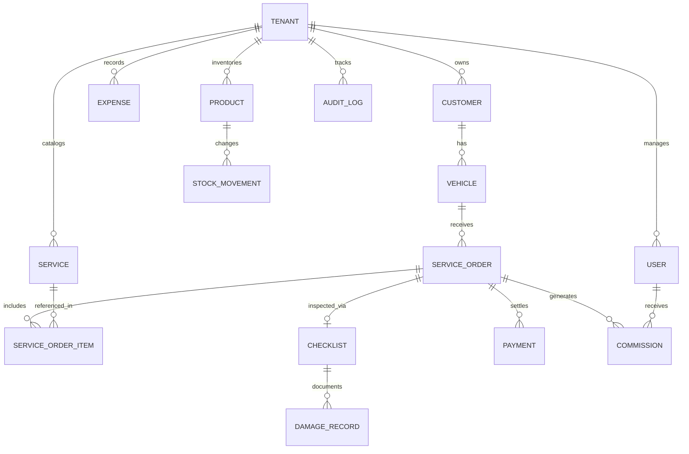

# Arquitetura Técnica — SaaS de Gestão para Estética Automotiva & Detailing

> **Data de Criação:** 09/11/2026  
> **Status:** Aprovado para Implementação da Fase 1  
> **Localização do Projeto:** `C:\Users\filip\.gemini\antigravity\scratch\saas-estetica-automotiva`

---

## 1. Visão Geral da Arquitetura

O sistema é concebido como uma plataforma SaaS Multi-Tenant nativa, escalável e resiliente, desenhada para operação intensiva em oficinas de estética automotiva, lava-jatos e estúdios de detailing.

### Princípios Arquiteturais Fundamentais
1. **Multi-tenancy Rígido:** Isolamento lógico por `tenant_id` em todas as tabelas operacionais. Nenhuma query de backend ou API pode omitir o filtro por `tenant_id`.
2. **Autorização no Backend (RBAC):** Os perfis `ADMIN` e `OPERATOR` são validados em nível de middleware e Route Handlers. Não se confia na omissão visual de elementos do frontend.
3. **Integridade Financeira & Imutabilidade de Vendas:** Uma vez que uma Ordem de Serviço ou Orçamento é aprovado/concluído, os valores históricos são congelados em snapshots nos itens da OS para evitar que futuras alterações na tabela de preços corrompam o DRE histórico.
4. **Operação Offline-first / Mobile-ready:** Interface otimizada para tablets na pista de lavagem e smartphones para captura de fotos de checklist e avarias via câmera.

---

## 2. Stack Tecnológica

| Camada | Tecnologia | Motivo da Decisão |
| :--- | :--- | :--- |
| **Framework Fullstack** | Next.js 14+ (App Router) + TypeScript | Unificação de frontend reativo e APIs tipadas com alta performance de renderização. |
| **Estilização** | Tailwind CSS + CSS Modules | Estilização minimalista, escura/clara profissional com classes utilitárias de baixa latência. |
| **Componentes de UI** | Radix UI Primitives + Componentes Customizados | Acessibilidade (a11y), suporte a teclado e composabilidade sem inchaço de bundles. |
| **Ícones** | Lucide React | Consistência iconográfica leve e padrão da indústria moderna. |
| **ORM & Modelagem** | Prisma ORM | Modelagem fortemente tipada, geração automática de tipos TypeScript e migrations versionadas. |
| **Banco de Dados** | SQLite (Dev Local Rápido) / PostgreSQL (Produção) | Zero fricção para execução imediata no ambiente local com migração direta para Postgres em produção via Prisma. |
| **Validação de Schemas** | Zod | Validação rígida nos limites da aplicação (DTOs, formulários e payloads de API). |
| **Autenticação & Sessão** | JWT seguro (jose) com Cookies HttpOnly + Bcrypt | Segurança contra XSS e CSRF, sem dependência de serviços externos que possam falhar. |
| **Documentos & PDFs** | @react-pdf/renderer | Geração de PDFs de alta fidelidade para orçamentos e vistorias digitais. |

---

## 3. Modelo de Dados Relacional (Prisma Schema Completo)

Todas as entidades operacionais herdam e indexam `tenant_id`.



### Entidades do Banco de Dados
1. `Tenant`: Empresa assinante do SaaS (Razão social, nome fantasia, documento, telefone, logotipo).
2. `User`: Usuários autenticados (`ADMIN` ou `OPERATOR`), hash de senha seguro, status ativo.
3. `Customer`: Clientes finais (Nome, telefone, WhatsApp, CPF/CNPJ, endereço, data de nascimento, notas).
4. `Vehicle`: Veículos (Placa única por tenant, modelo, marca, cor, ano, categoria: `HATCH`, `SEDAN`, `SUV_PICKUP`, `MOTORCYCLE`, `SPECIAL_UTILITY`).
5. `Service`: Catálogo de serviços estéticos com matriz de preços por categoria de veículo e tempo estimado.
6. `ServiceOrder`: Ordens de Serviço e orçamentos com status: `BUDGET_PENDING`, `BUDGET_APPROVED`, `TODO`, `IN_PROGRESS`, `DONE`, `PAID`, `CANCELLED`.
7. `ServiceOrderItem`: Snapshot dos serviços contratados (preço histórico congelado, comissão congelada).
8. `Checklist`: Vistoria de entrada com combustível, pertences e evidências fotográficas.
9. `DamageRecord`: Avarias identificadas na silhueta 360º (área, tipo de avaria, descrição, foto).
10. `Expense`: Despesas categorizadas (Produtos, Salários, Comissões, Aluguel, Água, Luz, etc.).
11. `Commission`: Comissões apuradas por colaborador e serviço com status de pagamento.
12. `Payment`: Transações financeiras reais com forma de pagamento (Dinheiro, PIX, Cartão Débito/Crédito).
13. `Product` & `StockMovement`: Controle de insumos químicos e materiais com histórico de entradas/saídas.
14. `AuditLog`: Registro de trilha de auditoria para ações sensíveis de usuários.

---

## 4. Estrutura de Diretórios do Projeto

```text
saas-estetica-automotiva/
├── docs/                      # Documentação técnica e governança do projeto
│   ├── ARCHITECTURE.md
│   ├── PROJECT_STATUS.md
│   ├── IMPLEMENTATION_CHECKLIST.md
│   ├── CHANGELOG.md
│   └── KNOWN_ISSUES.md
├── prisma/                    # Schema de banco de dados e migrations
│   ├── schema.prisma
│   └── seed.ts                # Seed com dados de teste para ambiente de desenvolvimento
├── src/
│   ├── app/                   # Next.js App Router (Páginas e Route Handlers)
│   │   ├── (auth)/            # Rotas públicas de login e registro de tenant
│   │   ├── (dashboard)/       # Layout protegido do sistema (Sidebar + Header)
│   │   │   ├── dashboard/     # Módulo 01 - Dashboard Executivo
│   │   │   ├── patio/         # Módulo 06 - Pátio Kanban
│   │   │   ├── clientes/      # Módulo 02 - Clientes e Veículos
│   │   │   ├── servicos/      # Módulo 03 - Serviços e Matriz de Preços
│   │   │   ├── vistoria/      # Módulo 04 - Recepção e Vistoria Digital
│   │   │   ├── orcamentos/    # Módulo 05 - Orçamentos e Propostas
│   │   │   ├── os/            # Módulo 06/07 - Ordens de Serviço
│   │   │   ├── estoque/       # Módulo 08 - Insumos e Produtos
│   │   │   ├── financeiro/    # Módulo 09 - DRE e Fluxo Financeiro
│   │   │   ├── comissoes/     # Módulo 10 - Apuração de Comissões
│   │   │   ├── crm/           # Módulo 11 - Retenção e Campanhas de Chuva
│   │   │   └── configuracoes/ # Configurações da Empresa e Usuários
│   │   └── api/               # Endpoints REST protegidos com validação Zod
│   ├── components/            # Componentes reutilizáveis de interface
│   │   ├── ui/                # Botões, inputs, cards, dialogs, badges, skeletons
│   │   ├── layout/            # Sidebar responsiva, navbar de usuário, breadcrumbs
│   │   └── modules/           # Componentes específicos de cada domínio
│   ├── lib/                   # Utilitários globais
│   │   ├── prisma.ts          # Singleton do cliente Prisma
│   │   ├── auth.ts            # Helpers de JWT, hashing bcrypt e extração de sessão
│   │   ├── permissions.ts     # Verificações de papéis RBAC (ADMIN vs OPERATOR)
│   │   └── api-response.ts    # Padronização de respostas JSON e tratamento de erros
│   └── types/                 # Declarações globais de tipos e DTOs
├── public/                    # Silhuetas veiculares em SVG e assets estáticos
├── package.json
├── tailwind.config.ts
└── tsconfig.json
```

---

## 5. Matriz de Permissões (RBAC)

| Módulo / Rota | Administrador / Dono | Operador / Funcionário | Justificativa |
| :--- | :---: | :---: | :--- |
| **Dashboard Financeiro & DRE** | ✅ Acesso Total | ❌ Bloqueado | Proteção de dados estratégicos e lucro da empresa. |
| **Pátio Kanban** | ✅ Visualiza & Move | ✅ Visualiza & Move | Operação essencial de chão de fábrica / pista. |
| **Vistoria & Checklist 360º** | ✅ Cria, Edita & Imprime | ✅ Cria, Edita & Imprime | Operador recebe o carro e fotografa avarias. |
| **Orçamentos & Preços** | ✅ Cria, Edita & Aplica Desconto | ⚠️ Apenas Consulta | Operador não altera margens sem autorização. |
| **Catálogo de Serviços** | ✅ Cria, Edita & Altera Preço | ❌ Apenas Leitura | Precificação é decisão gerencial. |
| **Gestão de Funcionários** | ✅ Cria, Edita & Define Papéis | ❌ Bloqueado | Gestão administrativa restrita. |
| **Comissões de Outros** | ✅ Visualiza Todas | ❌ Bloqueado | Operador vê apenas suas próprias comissões. |

